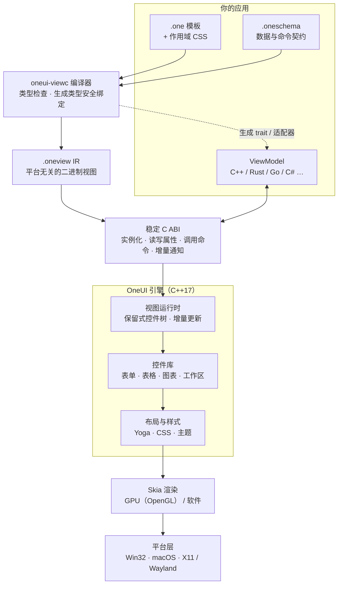

<div align="center">

# OneUI

**原生、高性能、任何语言都能驱动的桌面 UI 引擎**

用 `.one` 模板声明界面，用 C++、Rust 或任何能调用 C 的语言编写业务逻辑。<br>
Skia 原生绘制，不需要 WebView，不需要 JavaScript，没有浏览器运行时。

[官网](https://oneui.too1.net/) · [组件文档](https://oneui.too1.net/docs/14-component-reference) · [快速接入](docs/sdk-quick-start.md) · [English](README_EN.md)

`MIT` · `C++17` · `Rust` · `C ABI` · `Windows / macOS / Linux` · `0.1 开发版`

</div>

---

## 为什么选择 OneUI

| | |
|---|---|
| ⚡ **真正的原生性能** | Skia 直接绘制，支持 GPU（OpenGL / Ganesh）与软件两套后端。综合实验台在图表、2,500 个粒子、10,000 行列表同时运行时可达 **约 182 FPS**，进程 CPU **1.3%**。 |
| 🧩 **界面与语言彻底解耦** | `.one` 模板编译成平台无关的 IR，通过稳定的 C ABI 驱动。**同一份界面，C++、Rust 都能直接使用**，Go、C# 等语言也能按协议接入。换后端语言，界面无需重写。 |
| 🛡️ **编译期就发现错误** | `.oneschema` 契约描述页面数据和命令；绑定错的字段、写错的类型、事件参数不匹配，在**构建时**就会报错并指向源码行，而不是在运行时才崩溃。 |
| 🔁 **保留式控件树，精确增量更新** | 控件只创建一次。状态变化只刷新受影响的属性；列表按稳定 key 增量插入、删除、移动，**不会每帧重建页面**，空闲时零额外绘制。 |
| 🎨 **主题、密度、CSS 热更新** | 内置浅色、深色主题和两档密度，样式用 CSS 编写。开发时修改 CSS 即时生效，输入、焦点、滚动位置都不丢失。 |
| 🪟 **复杂桌面交互开箱即用** | 分屏网格、可拖拽停靠、浮动面板、标签拖出合并、方向键导航、容器查询……终端、IDE、运维控制台需要的工作区能力都已内置。 |
| 🔍 **内置性能诊断** | 按 F12 即可看到慢绘制、动画卡顿和耗时控件，并直接定位到 `.one` 源码行。默认关闭，零开销。 |
| 📦 **预编译 SDK** | 提供 Windows、macOS arm64、Linux x64 预编译包，业务项目通过 CMake 或 Rust 直接链接，**不必编译 Skia**。 |

## 实际运行效果


<div align="center">

Release · OpenGL + Skia Ganesh · RTX 5080 —— UI 更新 **~182 FPS** · 平均帧间隔 **5.49 ms** · P95 **5.84 ms** · CPU **1.3%** · 工作集 **~112 MB**

</div>

运行 `.\examples\performance_lab\run.ps1` 即可在本机看到同一页面。

## 架构



**分层原则：** 界面结构写在 `.one`，数据与命令的约定写在 `.oneschema`，业务状态放在 ViewModel，而 ViewModel **不创建任何控件**。所有语言都经过同一个 C ABI，所以界面与业务逻辑可以分别演进、分别测试。

| 概念 | 作用 |
|---|---|
| `.one` | 声明式界面模板：组件、绑定、事件、条件、列表、插槽、作用域 CSS |
| `.oneschema` | 页面的数据契约：属性（只读或读写）、类型、列表项模型、命令签名 |
| `oneui-viewc` | 编译器：校验模板与契约，生成 `.oneview` IR 和各语言的类型安全绑定 |
| `.oneview` IR | 版本化的二进制视图描述，带契约哈希；模板和 ViewModel 版本不匹配时直接拒绝加载 |
| ViewModel | 你的业务状态与命令，用任意语言实现，通过 C ABI 与界面通信 |
| C ABI | 唯一的跨语言边界：实例化视图、读写属性、调用命令、列表增量通知 |

## 快速上手

### 1. 用模板描述界面

```html
<!-- Settings.one -->
<template view-model="Settings">
  <SettingsPage title="连接设置">
    <Section title="基本信息">
      <FormGrid>
        <FormRow label="名称"><Input v-model="name" /></FormRow>
        <FormRow label="主机"><Input v-model="host" /></FormRow>
      </FormGrid>
    </Section>
    <ActionBar><Button @click="save">保存</Button></ActionBar>
  </SettingsPage>
</template>
```

```text
// Settings.oneschema
model Settings {
  rw name: utf8
  rw host: utf8
  command save()
}
```

窗口变窄时，`FormGrid` 会自动从双列变为单列，不需要写任何尺寸判断。

### 2. 用你熟悉的语言实现 ViewModel

> **版本说明**：`.oneschema` 契约、`oneui-viewc` 编译器、视图 C ABI（`oneui_view_*`）和 Rust 的 `oneui::view` 模块目前只在**源码构建**中提供，当前公开的 `0.1.0-preview.1` 预编译 SDK 还不包含，将随下一个预编译版本一起发布。现在想使用这条链路，请按下文"从源码构建"操作。

- **Rust**：`viewc --emit rust` 生成类型安全的 trait，你只需实现它。完整示例见 [examples/language_neutral_views](examples/language_neutral_views)：纯 Rust ViewModel，不需要任何 C++ 胶水代码。
- **C++**：使用 `State`、`Computed`、`VmCommand`，同一份模板同样适用。见 [examples/declarative](examples/declarative)。
- **其他语言**：按 [C ABI 与 ViewModel 协议](docs/59-language-neutral-views.md) 实现一张 VTable 即可。

### 3. 或者直接用 C++ 组合

```cpp
#include <oneui/ui_declarative_app.h>
#include <oneui/ui_compose.h>
#include <oneui/ui_theme.h>

int main() {
    oneui::ui::DeclarativeApp app(L"我的第一个 OneUI 页面", 760, 540);
    oneui::State<std::wstring> name{L"工作空间"};
    oneui::ui::Compose ui(app.mount());
    auto page = ui.settingsPage({
        ui.field(L"名称", ui.input(name)).hint(L"修改输入，下面的文字会跟着变化。"),
        ui.text(name)
    }).title(L"偏好设置");
    oneui::ui::applyTheme(app.mount());
    return app.run(page);
}
```

输入框和文字绑定同一个状态，输入时文字立即更新；绑定类型写错会在编译时报告。

**在业务项目中接入**，请使用[预编译 SDK](docs/sdk-quick-start.md)：下载对应平台的包，通过 CMake 或 Rust 绑定链接即可。

## 组件一览

| 类别 | 组件 |
|---|---|
| 页面骨架 | `SettingsPage`、`ListPage`、`DetailPage`、`Section`、`ActionBar`、`Workspace`、`DockPanel` |
| 表单 | `FormGrid`、`FormRow`、`Input`、`Select`、`Switch`、`Slider`、`FontPicker`、`MediaPicker` |
| 数据展示 | `DataTable`、`TimeSeriesChart`、`Card`，以及原生虚拟化列表 |
| 工作区 | `PaneGrid`、`PaneHeader`、`DockWorkspace`、`Tabs`（支持拖出）、拖放落点、方向导航 |
| 原生内容 | `NativeHost`：嵌入终端、编辑器、远程画面等原生内容 |
| 样式能力 | CSS 变量、作用域样式、容器查询、`ThemeScope`、阴影、多色渐变、动效 |

完整属性与示例见[组件文档](https://oneui.too1.net/docs/14-component-reference)。

## 性能数据

所有数据都来自仓库中可复现的测试，并附有原始数据与测量方法。

| 场景 | 结果 | 详情 |
|---|---|---|
| 综合实验台（图表 + 2,500 粒子 + 10,000 行列表） | ~182 FPS · 平均帧间隔 5.49 ms · CPU 1.3% | 本页截图 |
| `.one` 模板 vs 手写 C++（连接页，三轮） | CPU paint 4.04 / 4.04 ms · 工作集 100.38 / 100.12 MiB，**模板没有额外开销** | [报告](docs/40-declarative-stage-validation.md#性能测量) |
| IR + 任意语言 VM vs 手写（9 万个配对样本） | 设置页与 1,000 行列表的增删改移，median 和 P95 均在 **+10%** 以内 | [原始数据](docs/benchmarks/language-neutral-views/) |
| 分屏工作区动画（236,557 帧，16 个窗格） | 最大 15.2 ms · P95 4.2 ms · **超过 16 ms 的帧为 0** | [设计与数据](docs/60-workspace-interaction-components.md) |
| 表格滚动：GPU vs 软件 | 每次绘制 0.95 ms vs 7.62 ms | [渲染后端选择](docs/41-renderer-selection-and-product-boundaries.md) |
| 粒子网格合批 | GPU 路径绘制耗时下降约 20% | [网格默认化](docs/47-particle-mesh-default.md) |
| 阴影优化 | 平均绘制 1.09 → 0.62 ms · 工作集 170 → 109 MiB | [效果与实测](docs/52-layout-recipes-and-presets.md#最终同机实测2026-09-28) |

> paint 指 CPU 侧的控件绘制耗时，不等同于 GPU 执行时间或显示器帧率。测量环境：Windows 10、Ryzen 9 9950X3D、RTX 5080、MSVC Release。

## 开发体验

- **CSS 热更新**：加 `-Dev` 启动后，修改样式立即生效；样式写错时保留上一份有效样式，并给出准确的行列位置。
- **模板热重载**：开发模式下修改 `.one` 会原地重载，ViewModel 的状态不丢失。
- **严格诊断**：未知组件、未知属性、类型不匹配、选择器写错，都会在构建或加载时明确报错，不会悄悄失效。
- **内置性能诊断**：调用 `window->enableDeveloperTools()`，或设置环境变量 `ONEUI_DEVTOOLS=1`；按 F12 打开诊断面板，Ctrl+F12 导出报告。[使用说明](docs/54-built-in-developer-tools.md)
- **可复现的回归**：试验台内置交互、截图与动效连续性检查，失败时保留逐帧数据。

## 从源码构建（Windows）

> 只有开发 OneUI 本身或运行试验台才需要这一步。业务项目请直接使用[预编译 SDK](docs/sdk-quick-start.md)。

需要 Git、Python 3、PowerShell，以及 Visual Studio / Build Tools 的"使用 C++ 的桌面开发"（含 Windows SDK、CMake 3.20+、Ninja）。首次编译 Skia 最耗时，之后只需增量构建。

```powershell
git clone https://github.com/too1soft/OneUi.git
cd OneUi

# 首次准备 Skia（自动查找 VS 与 Windows SDK；需要代理时加 -Proxy http://127.0.0.1:端口）
$vswhere = "${env:ProgramFiles(x86)}/Microsoft Visual Studio/Installer/vswhere.exe"
$vs = & $vswhere -latest -requires Microsoft.VisualStudio.Component.VC.Tools.x86.x64 -property installationPath
$sdk = (Get-ItemProperty 'HKLM:\SOFTWARE\Microsoft\Windows Kits\Installed Roots').KitsRoot10
.\scripts\build-skia-static.ps1 -Fetch -SyncDeps -Generate -Build -WinVc "$vs/VC" -WinSdk $sdk
```

然后选一个示例运行：

```powershell
.\examples\performance_lab\run.ps1 -Build                  # 性能实验台：图表、粒子、虚拟列表、实时指标
.\examples\performance_lab\run.ps1 -Build -Components      # 默认表单、深浅主题、自适应布局、紧凑密度
.\examples\declarative\run.ps1 -Build -Dev                 # 学习示例：设置、校验、连接列表，CSS 热更新
.\examples\performance_lab\run.ps1 -Build -Effects         # 阴影、渐变与动效
.\examples\performance_lab\run.ps1 -Renderer cpu           # 切换为软件渲染（默认优先 GPU）
```

示例只使用本地模拟数据，不连接任何外部服务。更多参数见[实验台说明](examples/performance_lab/README.md)和[构建指南](docs/12-getting-started.md)。

## 平台与当前阶段

| 平台 | 状态 |
|---|---|
| Windows 10+ | 主线平台，功能与验收最完整 |
| Linux x64（X11 / Wayland） | 提供预编译 SDK，已在 WSLg 构建运行；原生桌面验收进行中 |
| macOS arm64 | 提供预编译 SDK，验收进行中 |

OneUI 目前是 **0.1 开发版**：声明式开发、多语言视图协议、工作区组件均已交付并有回归测试，API 仍在演进，暂不承诺稳定性。真实系统下 125% / 150% DPI、跨屏、中文输入法候选窗口等场景仍在验收中。详见[平台支持矩阵](docs/37-native-desktop-backends.md)。

## 文档导航

| 我想…… | 去看 |
|---|---|
| 在项目里接入 OneUI | [预编译 SDK 接入](docs/sdk-quick-start.md) · [C++ 构建](docs/12-getting-started.md) · [Rust 绑定](bindings/rust/README.md) |
| 学习写页面 | [声明式写法](docs/35-declarative-authoring-v1.md) · [页面布局模式](docs/36-declarative-page-patterns.md) · [从字段到完整页面](docs/48-connection-page-recipes.md) |
| 了解多语言视图协议 | [语言无关的声明式视图](docs/59-language-neutral-views.md) · [C ABI](docs/c-abi-integration.md) |
| 做复杂工作区 | [工作区交互组件](docs/60-workspace-interaction-components.md) |
| 查组件 API | [组件文档（官网）](https://oneui.too1.net/docs/14-component-reference) · [能力参考](docs/capabilities-reference.md) |
| 理解内部设计 | [架构](docs/01-architecture.md) · [渲染与验证](docs/39-rendering-and-validation.md) · [无障碍](docs/15-accessibility.md) |

源码结构：公共头文件在 `include/oneui/`，控件实现在 `src/core/`，视图运行时在 `src/views/`，模板编译器在 `tools/viewc/`，示例与回归测试分别在 `examples/` 和 `tests/`。

## 许可

[MIT](LICENSE)。第三方依赖见 [third_party/README.md](third_party/README.md)。
