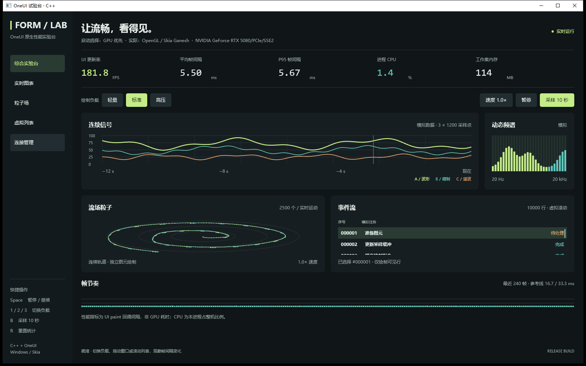
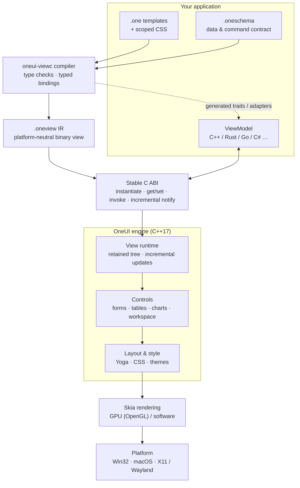

<div align="center">

# OneUI

**A native, high-performance desktop UI engine you can drive from any language**

Declare the interface in `.one` templates; write the logic in C++, Rust, or anything that can call C.<br>
Rendered natively with Skia — no WebView, no JavaScript, no browser runtime.

[Website](https://oneui.too1.net/) · [Component docs](https://oneui.too1.net/docs/14-component-reference) · [Get started](docs/sdk-quick-start.md) · [简体中文](README.md)

`MIT` · `C++17` · `Rust` · `C ABI` · `Windows / macOS / Linux` · `0.1 preview`

</div>

---

## Why OneUI

| | |
|---|---|
| ⚡ **Truly native speed** | Skia draws directly, with GPU (OpenGL / Ganesh) and software back ends. The lab page runs charts, 2,500 particles and a 10,000-row list at **~182 FPS** with **1.3%** process CPU. |
| 🧩 **UI decoupled from language** | `.one` templates compile to a platform-neutral IR driven through a stable C ABI. **The same UI works from C++ and Rust**, and Go, C# and others can plug in through the same protocol. Switch back-end languages without rewriting the interface. |
| 🛡️ **Errors caught at build time** | A `.oneschema` contract describes each page's data and commands. Wrong fields, wrong types and mismatched event arguments fail the **build** with the template line, instead of crashing at run time. |
| 🔁 **Retained tree, precise updates** | Controls are created once. State changes refresh only affected properties; lists insert, remove and move by stable key. **No per-frame page rebuilds**, and zero extra paints when idle. |
| 🎨 **Themes, density, live CSS** | Light and dark themes and two densities are built in, styled with CSS. Edit CSS during development and see it instantly — input, focus and scroll positions are kept. |
| 🪟 **Rich desktop interaction included** | Split grids, drag-to-dock, floating panels, tab drag-out, directional navigation and container queries — the workspace features terminals, IDEs and consoles need. |
| 🔍 **Built-in performance diagnostics** | Press F12 to see slow paints, animation stalls and expensive controls, mapped back to `.one` source lines. Off by default with zero overhead. |
| 📦 **Prebuilt SDK** | Packages for Windows, macOS arm64 and Linux x64. Link through CMake or Rust **without building Skia**. |

## See it running



<div align="center">

Release · OpenGL + Skia Ganesh · RTX 5080 — UI updates **~182 FPS** · mean frame interval **5.49 ms** · P95 **5.84 ms** · CPU **1.3%** · working set **~112 MB**

</div>

Run `.\examples\performance_lab\run.ps1` to see the same page on your machine.

## Architecture



**Layering:** structure lives in `.one`, the data contract in `.oneschema`, business state in the ViewModel — and the ViewModel **never creates controls**. Every language goes through the same C ABI, so UI and logic evolve and are tested independently.

| Concept | Role |
|---|---|
| `.one` | Declarative template: components, bindings, events, conditions, lists, slots, scoped CSS |
| `.oneschema` | The page contract: read-only / read-write properties, types, list item models, command signatures |
| `oneui-viewc` | Compiler: validates template and contract, emits `.oneview` IR and typed bindings per language |
| `.oneview` IR | Versioned binary view with a contract hash; a template/ViewModel mismatch is rejected on load |
| ViewModel | Your state and commands, in any language, talking to the UI only through the C ABI |
| C ABI | The single cross-language boundary: instantiate views, read/write properties, invoke commands, list deltas |

## Quick start

### 1. Describe the UI

```html
<!-- Settings.one -->
<template view-model="Settings">
  <SettingsPage title="Connection">
    <Section title="Basics">
      <FormGrid>
        <FormRow label="Name"><Input v-model="name" /></FormRow>
        <FormRow label="Host"><Input v-model="host" /></FormRow>
      </FormGrid>
    </Section>
    <ActionBar><Button @click="save">Save</Button></ActionBar>
  </SettingsPage>
</template>
```

```text
// Settings.oneschema
model Settings {
  rw name: utf8
  rw host: utf8
  command save()
}
```

`FormGrid` switches from two columns to one as the window narrows — no size checks in your code.

### 2. Implement the ViewModel in your language

- **Rust**: `viewc --emit rust` generates a typed trait for you to implement. See [examples/language_neutral_views](examples/language_neutral_views) — a pure-Rust ViewModel with no C++ glue.
- **C++**: use `State`, `Computed` and `VmCommand` with the same template. See [examples/declarative](examples/declarative).
- **Other languages**: implement one VTable following the [C ABI and ViewModel protocol](docs/59-language-neutral-views.md).

### 3. Or compose directly in C++

```cpp
#include <oneui/ui_declarative_app.h>
#include <oneui/ui_compose.h>
#include <oneui/ui_theme.h>

int main() {
    oneui::ui::DeclarativeApp app(L"My first OneUI page", 760, 540);
    oneui::State<std::wstring> name{L"Workspace"};
    oneui::ui::Compose ui(app.mount());
    auto page = ui.settingsPage({
        ui.field(L"Name", ui.input(name)).hint(L"Type here and the text below follows."),
        ui.text(name)
    }).title(L"Preferences");
    oneui::ui::applyTheme(app.mount());
    return app.run(page);
}
```

**For your own project**, use the [prebuilt SDK](docs/sdk-quick-start.md) and link it with CMake or the Rust bindings.

## Components

| Category | Components |
|---|---|
| Page skeletons | `SettingsPage`, `ListPage`, `DetailPage`, `Section`, `ActionBar`, `Workspace`, `DockPanel` |
| Forms | `FormGrid`, `FormRow`, `Input`, `Select`, `Switch`, `Slider`, `FontPicker`, `MediaPicker` |
| Data | `DataTable`, `TimeSeriesChart`, `Card`, plus native virtualized lists |
| Workspace | `PaneGrid`, `PaneHeader`, `DockWorkspace`, `Tabs` (with drag-out), drop targets, directional navigation |
| Native content | `NativeHost` for terminals, editors and remote frames |
| Styling | CSS variables, scoped styles, container queries, `ThemeScope`, shadows, multi-stop gradients, motion |

Full properties and examples: [component docs](https://oneui.too1.net/docs/14-component-reference).

## Performance

Every number below comes from a reproducible test in this repository, with raw data and method.

| Scenario | Result | Details |
|---|---|---|
| Lab page (charts + 2,500 particles + 10,000-row list) | ~182 FPS · 5.49 ms mean frame interval · 1.3% CPU | screenshot above |
| `.one` template vs hand-written C++ (connection page, 3 rounds) | CPU paint 4.04 / 4.04 ms · working set 100.38 / 100.12 MiB — **no template overhead** | [report](docs/40-declarative-stage-validation.md) |
| IR + any-language VM vs hand-written (90,000 paired samples) | Settings page and 1,000-row list edits within **+10%** at median and P95 | [raw data](docs/benchmarks/language-neutral-views/) |
| Split-workspace motion (236,557 frames, 16 panes) | max 15.2 ms · P95 4.2 ms · **zero frames over 16 ms** | [design & data](docs/60-workspace-interaction-components.md) |
| Table scrolling: GPU vs software | 0.95 ms vs 7.62 ms per paint | [renderer selection](docs/41-renderer-selection-and-product-boundaries.md) |
| Particle mesh batching | ~20% lower GPU-path paint time | [mesh default](docs/47-particle-mesh-default.md) |

> "Paint" is CPU-side control drawing, not GPU execution time or display frame rate. Environment: Windows 10, Ryzen 9 9950X3D, RTX 5080, MSVC Release.

## Developer experience

- **Live CSS** with `-Dev`; invalid CSS keeps the last good stylesheet and reports exact line and column.
- **Template hot reload** in development, keeping ViewModel state.
- **Strict diagnostics** for unknown components, properties, types and selectors — nothing fails silently.
- **Built-in diagnostics**: `window->enableDeveloperTools()` or `ONEUI_DEVTOOLS=1`; F12 toggles the panel, Ctrl+F12 exports a report. [Guide](docs/54-built-in-developer-tools.md)

## Build from source (Windows)

> Only needed to develop OneUI itself or run the lab. Applications should use the [prebuilt SDK](docs/sdk-quick-start.md).

Requires Git, Python 3, PowerShell and Visual Studio / Build Tools with "Desktop development with C++" (Windows SDK, CMake 3.20+, Ninja). The first Skia build takes the longest; later builds are incremental.

```powershell
git clone https://github.com/too1soft/OneUi.git
cd OneUi
$vswhere = "${env:ProgramFiles(x86)}/Microsoft Visual Studio/Installer/vswhere.exe"
$vs = & $vswhere -latest -requires Microsoft.VisualStudio.Component.VC.Tools.x86.x64 -property installationPath
$sdk = (Get-ItemProperty 'HKLM:\SOFTWARE\Microsoft\Windows Kits\Installed Roots').KitsRoot10
.\scripts\build-skia-static.ps1 -Fetch -SyncDeps -Generate -Build -WinVc "$vs/VC" -WinSdk $sdk

.\examples\performance_lab\run.ps1 -Build                  # performance lab
.\examples\performance_lab\run.ps1 -Build -Components      # forms, themes, adaptive layout
.\examples\declarative\run.ps1 -Build -Dev                 # learning sample with live CSS
```

Samples use local simulated data only. More in the [lab guide](examples/performance_lab/README.md) and [build guide](docs/12-getting-started.md).

## Platforms and status

| Platform | Status |
|---|---|
| Windows 10+ | Main platform, most complete coverage |
| Linux x64 (X11 / Wayland) | Prebuilt SDK; runs under WSLg, native desktop validation in progress |
| macOS arm64 | Prebuilt SDK; validation in progress |

OneUI is a **0.1 preview**. Declarative authoring, the any-language view protocol and workspace components are delivered with regression tests; the API is still evolving. 125% / 150% DPI on real systems, multi-monitor and IME candidate windows are still being validated. See the [platform matrix](docs/37-native-desktop-backends.md).

## License

[MIT](LICENSE). Third-party notices in [third_party/README.md](third_party/README.md).
