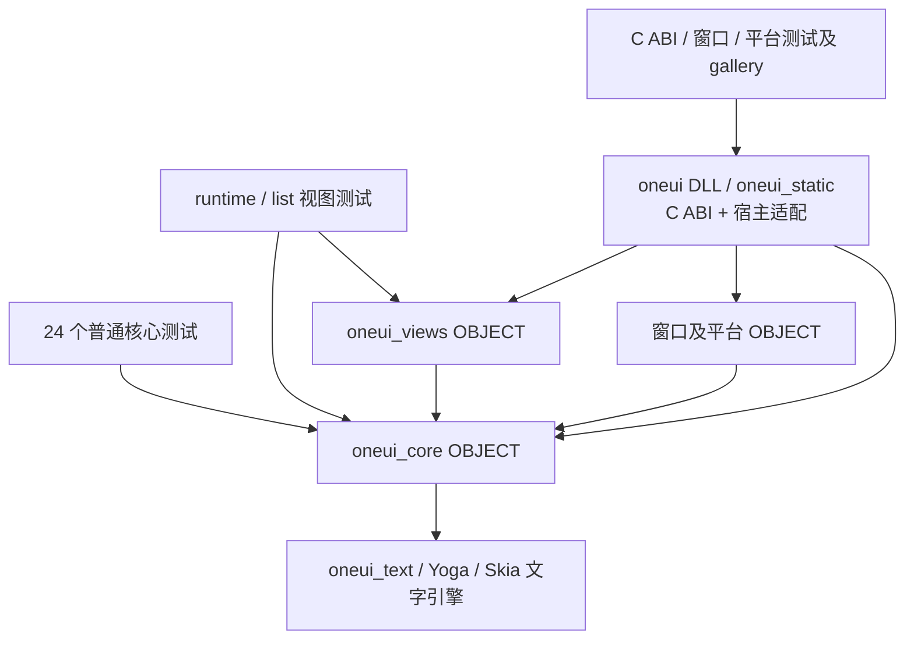

# WP3 S3：C ABI 与生命周期检查点

2026-10-10。S3 首次验收未通过；本次已修正分层及菜单回归，26 个指定目标全部重新链接/运行通过，等待正常终端复核。停止在 S3，不开展 S4。

## 1. ABI 与设计差异

实施前只读核对 `git -C E:/project/byname/oneui log main -1`：2aa15e9；main 的 `ONEUI_UTF8_ABI_VERSION=43`。本工作树采用 **44**。主 C 头、oneui-sys 版本常量、supported-symbols 清单同步；新增 **20** 个 `oneui_view_*` 导出，放在独立领域文件，未向 `src/capi/oneui_c_api.cpp` 追加。

最终协议头为 `include/oneui/oneui_view_c_api.h`，由主头包含。相对 design-2：

1. R1–R4 的所有权/签名保持：UTF-8 借用且立即复制；无 value release；列表用属性 ID；独立 View 句柄；RESET 同 key 换 VM 视为替换。
2. 补充协议/值/变更类型常量以及窗口、mount、borrowed root/host 的失效和线程说明，不改变草案结构布局。
3. `oneui_view_reload` 尚未导出，归 S5 实现；没有返回成功的占位函数。其余本阶段 API 已实现。
4. 按用户要求，S3 不写 Rust 回调或安全绑定。`pending-view-symbols.txt` 精确列出这 20 个等待 S4 Rust 声明的 C 导出，check-abi-sync 对它们额外核验 C 头/清单，其他符号仍严格 C/Rust 对齐。S4 添加声明时必须同时删除 pending 项；这不是永久 ABI 豁免。

dispatcher 捕获 weak runtime/mount，窗口或 mount 关闭时立即断开事件和通知门；View 句柄仍由调用者 destroy。native host 的 owner 租约随 detach/关闭释放。本次已从重新生成的配置直接编译/链接 DLL，并验证 20 个 View C 导出齐全；标准 Ninja 驱动仍待正常终端复核。

## 2. 生命周期与重入覆盖

`tests/views/c_api_tests.cpp` 的 11 个场景，加上 S2 runtime/list 场景，覆盖：

- UI 线程检查；跨线程 notifier retain/release；跨线程 notify 拒绝；保留 notifier 在 View 消失后返回 CLOSED。
- get 中 notify 拒绝；get 中销毁延迟释放；读到的借用值在回调尾声释放前完成复制。
- invoke 中销毁、立即关闭事件门、回调尾声释放；旧 native Button 再触发不会回调 VM；回调中 flush 拒绝。
- 通知合并、dispatcher 绘前刷新；嵌套消息循环遇到活动回调时推迟刷新并在尾声重新投递。
- failed connect 成对 disconnect/release；connect 中销毁 mount 回滚；busy mount 的输出句柄清空。
- window close 和 `oneui_window_destroy` 都先断开 View；关闭后仍可读诊断并 destroy View。
- NativeHost 的 owner retain/release；列表子 VM 租约平衡、同 key 替换、准备失败保持旧树，以及恢复成功后的错误诊断不误释放新 VM。

scope 的 disconnect 发生在 notifier 已关闭之后。外语回调不得跨 ABI unwind；测试中的 C++ bad_alloc 注入仅验证 native 失败清理。外语异步任务必须先借助现有 UI dispatcher 回到 UI 线程。

## 3. 分层修正与完整构建证据

### 根因与修正

Claude 的 `claude-ninja-k0.log` 确认 26 个测试链接失败。首次 S3 验证使用完整 `oneui_static.lib`，掩盖了底层对象对窗口/平台的反向依赖，因此首次“直接编译通过”不能作为核心层链接证据，本节取代该证据。

- `ONEUI_CORE_SOURCES` 移除全部视图源码。`OneUIViewRuntime.cmake` 在 core 创建后定义独立 OBJECT 目标 `oneui_views`，依赖 core；Windows/Linux/macOS 聚合 SDK 显式纳入 views。24 个普通核心失败目标仍只链接 core；只有 runtime/list 两个视图测试增加 views。
- `ui_declarative.h` 去掉 Window 头。原 `Window::closed()` 引用来自导出 Window 类的内联虚函数随头进入对象，不是运行时主动访问窗口。运行时只接受调度/拆挂载函数，C ABI 的 weak mount/runtime 控制块与 Window::observeClosed 适配存活状态；销毁与晚到任务测试保持通过。17 个 views 对象用 dumpbin 检查，不存在 Window::closed、SystemClipboard 或宿主默认剪贴板工厂的未解析引用。
- 旧 Mount 源码确实直接构造 SystemClipboard，TextField 本身没有自动系统剪贴板。现在沿用 TextField::setClipboard 注入点，Mount 保存抽象 Clipboard，repeat 子 Mount 继承它。默认参数调用的 `defaultMountClipboard()` 仅在宿主侧 `src/platform/shared/declarative_mount.cpp` 实现，保持旧调用者默认系统剪贴板；新 Runtime 显式接收 Clipboard，C ABI 注入 SystemClipboard，纯 views 测试注入 MemoryClipboard。没有全局可变服务注册器，也没有给底层测试补平台库。
- 真实运行 26 个程序时发现 native_menu 的额外回归：S2 将旧 reconcileChildren 改为严格 prepare 后拒绝菜单文档重挂载。恢复旧接口的 eager reparent 行为；严格的 prepareChildren/commit 仅由新 runtime 使用，其 OOM 保留旧树测试继续通过。

### 目标依赖图

箭头表示“依赖”。窗口和平台实现不进入 core/views；基础文字引擎原有的 Skia/系统字体库依赖保持不变。



Windows 聚合库显式嵌入 core/views/platform 对象；desktop 聚合目标链接 views/core 与平台对象。OBJECT 目标的使用要求与对象集合分别处理，未依赖传递 OBJECT 目标自动嵌入对象的假设。

### 实际构建方法

Mount 增加 Clipboard 成员后，首先成功执行 `ninja -C build/capture -t clean`（清除 344 项），再重新编译。

`cmake --build build/capture --parallel 4` 和 `ninja -C build/capture -k 0 -j 4` 均停在 glob 子进程；直接配置的 trace 进一步定位 Yoga 的 CheckIPOSupported 嵌套 Ninja 探测。正常文件读写及 MSVC 本身可执行。

本地临时 `CMAKE_PROJECT_yogacore_INCLUDE` 钩子使该可选 IPO 探测返回不支持，配置成功；没有修改第三方源码、源码 CMake 或优化实现。配置后检查实际命令，仍为原 RelWithDebInfo /O2 /Zi /DNDEBUG /MT。钩子已从 CMakeCache 删除，下一次普通配置恢复正常探测。

从**重新生成的真实配置**读取 `ninja -t commands all`，并用 `ninja -t compdb -x` 展开响应文件；按依赖顺序直接执行 MSVC。不是重建另一套库清单，也未加入 oneui_static/platform 到 core 测试。

```bat
call "D:\Program Files\Microsoft Visual Studio\18\Community\VC\Auxiliary\Build\vcvars64.bat"
cmake -S . -B build/capture -DCMAKE_PROJECT_yogacore_INCLUDE=E:/project/byname/oneui-views/build/capture/wp3-no-ipo-probe.cmake
C:/Users/Administrator/.local/bin/python3.14.exe -X utf8 -B build/capture/wp3-command-inventory.py
C:/Users/Administrator/.local/bin/python3.14.exe -X utf8 -B build/capture/wp3-replay.py
C:/Users/Administrator/.local/bin/python3.14.exe -X utf8 -B build/capture/wp3-layer-evidence.py
ctest --test-dir build/capture -j 8 --output-on-failure --timeout 60 --output-log build/capture/wp3-layer-ctest.log
```

直接执行范围：**277 个 C++ 编译命令、60 次链接、3 个 archive、5 个生成/C11 smoke 命令，全部完成**，包含 DLL、static SDK 和两个 gallery。为了绕过 Ninja/CMake 的子进程等待且约束产物体积，去掉 showIncludes 输出，直接调用 link/lib；链接改为 `/INCREMENTAL:NO /DEBUG:NONE /MANIFEST:EMBED`。对象、库、编译宏与实际配置相同；原生 DLL/EXE 保留正常嵌入 manifest，但没有链接 PDB/ILK。不能称为原封不动的标准 Ninja 构建，正常终端仍应 clean + ninja 复核。

`wp3-layer-evidence.json` 对原日志中的 26 个名字逐项检查实际链接命令：24 项无 views 对象，2 项包含 views；26 项均无 oneui_static、C API 或窗口平台对象。**26/26 均已运行退出 0**。首次全命令执行 105.67 秒；菜单修正后同一闭包增量重编并重新完成全部链接，21.73 秒。

### 测试结果

本次直接使用重新配置的 `build/capture/CTestTestfile.cmake`，没有补充测试注册文件，也没有复用 clean 前的测试二进制。**68 项：62 通过、6 失败，耗时 20.42 秒**。

| 失败项 | 归类 |
|---|---|
| oneui_windows_runtime_audit_tests | 既有外部 windows-compat hash 问题，未修改 |
| oneui_build_space_tests | Python 3.14 临时目录 ACL，8 个 unittest errors |
| oneui_icu_patch_recipe_tests | Git shell CreateFileMapping Win32 error 5 |
| oneui_win7_patch_recipe_tests | 同上 |
| oneui_win32_notification_activation_tests | HRESULT 2147942405（access denied） |
| oneui_backend_contract_tests | 当前 Windows desktop 无可用 tray |

后 5 项是此前 Claude 已确认的沙箱环境失败；本轮未把它们记为通过。新增 view CTest 全部通过：runtime **9** 场景、list **8** 场景、C ABI **11** 场景，合计 **28**；Python **29** 个方法及 C11 smoke 通过。新增剪贴板场景验证无平台输入/粘贴、repeat 服务传递、C ABI 和旧 Mount 的系统默认服务。菜单既有测试作为重挂载回归通过。

DLL 的 20 个 `oneui_view_*` 导出全部存在，ABI 同步 CTest 通过。最终 DLL SHA-256：`06485e69b3a8547c5b53f2abdd897a0c2f6b25d94ad2903d99021e56b5125bfb`。

可复核证据统一放在 capture：`wp3-commands.json`、`wp3-replay-results.json`、`wp3-layer-evidence.json`、`wp3-layer-symbols.json`、`wp3-layer-ctest.log`。源码未引入临时 IPO 钩子或备用执行器。

## 4. 产物与协作状态

复用固定 capture。上轮的旧中间对象与 ACL 清理拒绝仍保留记录；本轮 clean 已实际完成，未改原仓库只读输入。当前可读取 build 合计约 **18.49 GiB**，E: 空闲约 **62.74 GiB**，另有 8 个旧 fixture 无法读取大小，审计仍标记 incomplete。

新生成的菜单诊断副本和 8 个旧 build_space 测试 ACL 临时目录，删除被自动审批审查拒绝（blocked by policy），没有换工具绕过。第 7 节列当前完整清单；原 24 个遗留目录见 S1 报告。正常链接后的正式测试 EXE、DLL、lib 与当前证据保留；`build/artifact-state.json` 覆盖更新。

Git index.lock 写入此前已拒绝，本次按要求更新 S2/S3 提交信息及文件清单，注明共享 CMake hunks。MyStudio 只读上下文与 blueprint 已加载，kit 5；执行和交接未同步（本任务禁止审批型写入）。

## 5. 疑问与下一步

没有新的架构裁决请求。请正常终端复核 S3 的完整构建/CTest/DLL，审查借用生命周期与错误边界；通过后再授权 S4。S5 必须完成 C++ 单运行时迁移、CALL 树差分、热重载；S6 负责性能与真实焦点/IME。未提前实现这些阶段。

## 6. 文件清单

- `bindings/rust/oneui-sys/pending-view-symbols.txt`
- `bindings/rust/oneui-sys/src/lib.rs`
- `bindings/rust/oneui-sys/supported-symbols.txt`
- `cmake/OneUISources.cmake`（本阶段 hunk）
- `cmake/OneUITests.cmake`（本阶段 hunk）
- `cmake/OneUIViewTests.cmake`（本阶段 hunk）
- `docs/59-language-neutral-views-s3-report.md`
- `include/oneui/oneui_c_api.h`
- `scripts/check-abi-sync.cmake`
- `src/capi/oneui_c_api_view.cpp`
- `src/capi/oneui_c_api_view_host.cpp`
- `src/capi/oneui_c_api_view_internal.h`
- `src/capi/oneui_c_api_view_mount.cpp`
- `src/capi/oneui_c_api_view_notifier.cpp`
- `src/capi/oneui_c_api_view_window.cpp`
- `src/capi/oneui_c_api_view_window.h`
- `src/capi/oneui_c_api_window.cpp`
- `tests/views/c_api_tests.cpp`
- `tests/views/c_header.c`

共享 CMake 的具体切分说明见对应提交信息文件；src/views/format 包含从 tools/viewc 移动的文件。

## 7. 本轮受阻清理清单（已知大小降序）

| 绝对路径 | 占用 | 原因及手动前提 |
|---|---|---|
| [E:/project/byname/oneui-views/build/capture/wp3-obj](E:/project/byname/oneui-views/build/capture/wp3-obj) | 51,450,957 bytes（49.07 MiB） | 已结束的直接编译中间对象；自动审批审查拒绝删除（blocked by policy）。确认 cl/link/测试进程均结束后可删除。 |
| [C:/Users/Administrator/AppData/Local/Temp/tmp0eqgtccj](C:/Users/Administrator/AppData/Local/Temp/tmp0eqgtccj) | 未知（ACL 拒绝） | 全量旧 build_space 测试的过期 fixture；自动审批审查拒绝删除（blocked by policy）。需有权限的创建身份确认无测试占用后删除。 |
| [C:/Users/Administrator/AppData/Local/Temp/tmp_i2t12bo](C:/Users/Administrator/AppData/Local/Temp/tmp_i2t12bo) | 未知（ACL 拒绝） | 全量旧 build_space 测试的过期 fixture；自动审批审查拒绝删除（blocked by policy）。需有权限的创建身份确认无测试占用后删除。 |
| [C:/Users/Administrator/AppData/Local/Temp/tmpdhkrqr2i](C:/Users/Administrator/AppData/Local/Temp/tmpdhkrqr2i) | 未知（ACL 拒绝） | 全量旧 build_space 测试的过期 fixture；自动审批审查拒绝删除（blocked by policy）。需有权限的创建身份确认无测试占用后删除。 |
| [C:/Users/Administrator/AppData/Local/Temp/tmpfffs0exo](C:/Users/Administrator/AppData/Local/Temp/tmpfffs0exo) | 未知（ACL 拒绝） | 全量旧 build_space 测试的过期 fixture；自动审批审查拒绝删除（blocked by policy）。需有权限的创建身份确认无测试占用后删除。 |
| [C:/Users/Administrator/AppData/Local/Temp/tmpgqp61h6z](C:/Users/Administrator/AppData/Local/Temp/tmpgqp61h6z) | 未知（ACL 拒绝） | 全量旧 build_space 测试的过期 fixture；自动审批审查拒绝删除（blocked by policy）。需有权限的创建身份确认无测试占用后删除。 |
| [C:/Users/Administrator/AppData/Local/Temp/tmpmdzriqng](C:/Users/Administrator/AppData/Local/Temp/tmpmdzriqng) | 未知（ACL 拒绝） | 全量旧 build_space 测试的过期 fixture；自动审批审查拒绝删除（blocked by policy）。需有权限的创建身份确认无测试占用后删除。 |
| [C:/Users/Administrator/AppData/Local/Temp/tmpu1s95r9k](C:/Users/Administrator/AppData/Local/Temp/tmpu1s95r9k) | 未知（ACL 拒绝） | 全量旧 build_space 测试的过期 fixture；自动审批审查拒绝删除（blocked by policy）。需有权限的创建身份确认无测试占用后删除。 |
| [C:/Users/Administrator/AppData/Local/Temp/tmpu5r44yvy](C:/Users/Administrator/AppData/Local/Temp/tmpu5r44yvy) | 未知（ACL 拒绝） | 全量旧 build_space 测试的过期 fixture；自动审批审查拒绝删除（blocked by policy）。需有权限的创建身份确认无测试占用后删除。 |

另外 24 个旧 fixture 的完整绝对路径、未知大小及 ACL 处理前提，见 [S1 报告第 6 节](59-language-neutral-views-s1-report.md#6-产物清理与验收补记)。这些目录未计作已清理。

### 本次分层修正新增的受阻项

| 绝对路径 | 大小 | 原因与手动清理前提 |
|---|---|---|
| [E:/project/byname/oneui-views/build/capture/wp3-menu-probe.exe](E:/project/byname/oneui-views/build/capture/wp3-menu-probe.exe) | 11,385,344 bytes | 已结束的诊断/测试临时产物；自动审批审查拒绝删除（blocked by policy）。确认无 cl/link/测试占用，有权访问的创建身份可删除。 |
| [E:/project/byname/oneui-views/build/capture/wp3-menu-probe.obj](E:/project/byname/oneui-views/build/capture/wp3-menu-probe.obj) | 2,994,878 bytes | 已结束的诊断/测试临时产物；自动审批审查拒绝删除（blocked by policy）。确认无 cl/link/测试占用，有权访问的创建身份可删除。 |
| [E:/project/byname/oneui-views/build/capture/wp3-menu-probe.cpp](E:/project/byname/oneui-views/build/capture/wp3-menu-probe.cpp) | 9,012 bytes | 已结束的诊断/测试临时产物；自动审批审查拒绝删除（blocked by policy）。确认无 cl/link/测试占用，有权访问的创建身份可删除。 |
| [E:/project/byname/oneui-views/build/capture/wp3-menu-probe.rsp](E:/project/byname/oneui-views/build/capture/wp3-menu-probe.rsp) | 6,504 bytes | 已结束的诊断/测试临时产物；自动审批审查拒绝删除（blocked by policy）。确认无 cl/link/测试占用，有权访问的创建身份可删除。 |
| [E:/project/byname/oneui-views/build/capture/wp3-menu-probe.py](E:/project/byname/oneui-views/build/capture/wp3-menu-probe.py) | 1,525 bytes | 已结束的诊断/测试临时产物；自动审批审查拒绝删除（blocked by policy）。确认无 cl/link/测试占用，有权访问的创建身份可删除。 |
| [E:/project/byname/oneui-views/build/capture/wp3-menu-probe.cmd](E:/project/byname/oneui-views/build/capture/wp3-menu-probe.cmd) | 195 bytes | 已结束的诊断/测试临时产物；自动审批审查拒绝删除（blocked by policy）。确认无 cl/link/测试占用，有权访问的创建身份可删除。 |
| [C:/Users/Administrator/AppData/Local/Temp/tmp1ets0lyf](C:/Users/Administrator/AppData/Local/Temp/tmp1ets0lyf) | 未知（ACL 拒绝） | 已结束的诊断/测试临时产物；自动审批审查拒绝删除（blocked by policy）。确认无 cl/link/测试占用，有权访问的创建身份可删除。 |
| [C:/Users/Administrator/AppData/Local/Temp/tmp57ct9_8w](C:/Users/Administrator/AppData/Local/Temp/tmp57ct9_8w) | 未知（ACL 拒绝） | 已结束的诊断/测试临时产物；自动审批审查拒绝删除（blocked by policy）。确认无 cl/link/测试占用，有权访问的创建身份可删除。 |
| [C:/Users/Administrator/AppData/Local/Temp/tmp97anzm5d](C:/Users/Administrator/AppData/Local/Temp/tmp97anzm5d) | 未知（ACL 拒绝） | 已结束的诊断/测试临时产物；自动审批审查拒绝删除（blocked by policy）。确认无 cl/link/测试占用，有权访问的创建身份可删除。 |
| [C:/Users/Administrator/AppData/Local/Temp/tmpiu8jdo0d](C:/Users/Administrator/AppData/Local/Temp/tmpiu8jdo0d) | 未知（ACL 拒绝） | 已结束的诊断/测试临时产物；自动审批审查拒绝删除（blocked by policy）。确认无 cl/link/测试占用，有权访问的创建身份可删除。 |
| [C:/Users/Administrator/AppData/Local/Temp/tmpnbx_c7al](C:/Users/Administrator/AppData/Local/Temp/tmpnbx_c7al) | 未知（ACL 拒绝） | 已结束的诊断/测试临时产物；自动审批审查拒绝删除（blocked by policy）。确认无 cl/link/测试占用，有权访问的创建身份可删除。 |
| [C:/Users/Administrator/AppData/Local/Temp/tmpo4466nc7](C:/Users/Administrator/AppData/Local/Temp/tmpo4466nc7) | 未知（ACL 拒绝） | 已结束的诊断/测试临时产物；自动审批审查拒绝删除（blocked by policy）。确认无 cl/link/测试占用，有权访问的创建身份可删除。 |
| [C:/Users/Administrator/AppData/Local/Temp/tmpxxi1v5kt](C:/Users/Administrator/AppData/Local/Temp/tmpxxi1v5kt) | 未知（ACL 拒绝） | 已结束的诊断/测试临时产物；自动审批审查拒绝删除（blocked by policy）。确认无 cl/link/测试占用，有权访问的创建身份可删除。 |
| [C:/Users/Administrator/AppData/Local/Temp/tmpzpmekavc](C:/Users/Administrator/AppData/Local/Temp/tmpzpmekavc) | 未知（ACL 拒绝） | 已结束的诊断/测试临时产物；自动审批审查拒绝删除（blocked by policy）。确认无 cl/link/测试占用，有权访问的创建身份可删除。 |
