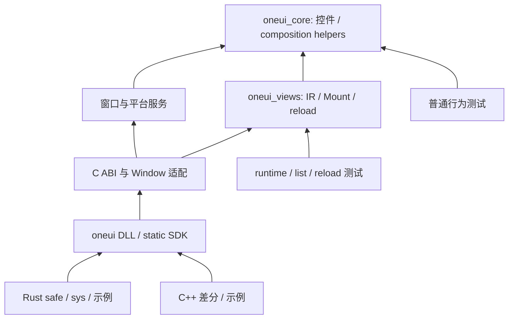

# WP3 S5：C++ 统一与开发热重载

基线 8bd0c2f。提交等待 Claude 验收；S4–S6 文件交叉，使用一个合并提交信息，
不把共享编译器/CMake/ABI 的代码块拆成不可编译的中间提交。

## 交付与依赖

- `tools/viewc/emit_cpp.{h,cpp}`、`include/oneui/view_cpp_{adapter,records}.h`、
  `src/views/cpp_mount.cpp`：生成嵌入 IR、schema hash、VM adapter；保留 build_X 与
  styles_X/sources_X，并提供 shared_ptr VM 重载及 scope_X。已删除 `tools/viewc/legacy.h`。
- 11 个示例 `.oneschema`、CMake SCHEMA 参数、现有 compiler/authoring 示例迁移。
  C++ 临时组合 VM 改为 shared_ptr，避免旧 emitter 只捕获字段、而新 adapter 保留整个
  VM 后引入栈对象悬空。C++ State/Computed 的订阅由 adapter connection 管理。
- `src/views/reload*.{h,cpp}`：以稳定 node ID、组件、CALL 链和 VM 身份匹配；保留
  Widget、列表行、焦点/IME/滚动；预构建新树，迁移样式、事件及依赖观察者，释放消失的
  列表 scope。删除显式属性时恢复组件默认值，flex 同步处理移除。
- `src/core/{text_field_composition,composition_references}.cpp`：提交 TextField
  composition，更新 Scroll/Split/AdaptivePanes 在 children 事务后的内容引用。
  既有公开类只新增非虚方法，没有新增数据成员或改变布局。
- `src/capi/oneui_c_api_view_reload.cpp`、Rust `view/reload.rs`：独立导出领域文件；
  文件 watcher 200 ms 合并写入，后台只读取 IR，UI 线程 reload，Drop 取消订阅并 join。
  watcher 不负责调用编译器；外部 viewc/build 产出 IR 后才触发。

依赖继续保持：

## 冻结 C ABI 的单独变更说明

S3 冻结的 44 原有签名、结构布局、UTF-8 借用、列表按属性 ID、独立 View、Host scope
参数均未改变。S5 **新增** `oneui_view_reload(OneUiView*, const uint8_t*, size_t)`，
因此全局 ABI 升为 **45**；主头、Rust 常量、原生版本函数、符号清单及 C smoke 断言同步。
核对只读 main 2aa15e9 的 ABI 为 43，45 未占用。视图协议版本仍为 1，IR 仍为 1.0。

理由：设计第 6/8 节要求该入口，S3 报告明确延期到 S5，S3 没有导出空实现。Rust 安全
API 需要通过已版本化的 C 边界调用共享 reload，不能在 Rust 重建第二份运行时。
此项是对冻结接口的新增扩展，须由 Claude 在最终检查点审阅，不能表述成完全没有 ABI 变化。

## 差分及生命周期验证

`tests/views/cpp_diff_tests.cpp` 使用同一 VM 数据，比较旧冻结输出和 IR 的树、默认值、
样式文本/字体/颜色/几何、输入回写、事件 trace、列表行身份、焦点/IME/选区/滚动、插槽，
以及 CALL 静态属性/class 合并、调用者绑定和事件透传。

旧编译器本来不支持 CALL 绑定/事件，因此 `DiffLegacy.g.h` 对该部分保存等价的根节点
展开结果（无包装节点），不是假称旧 emitter 已支持新能力。旧导入还缺调用者 CSS scope，
对应 class 规则采用双方相同的外部 CSS，scoped typography 另行比较。冻结输出仅为
测试 oracle，不能继续生成产品代码。

直接 MSVC 验证：

| 测试 | 结果 |
|---|---|
| C++ 新旧差分程序 | 通过 |
| declarative、connections、authoring、gallery、effects、motion | 6/6 程序通过 |
| 原有 compiler suite（含真实 MSVC 正反编译） | CTest 通过 |
| runtime / list | 9 / 8 场景通过 |
| reload | 50 次原位 + 50 次删除/恢复列表循环通过 |
| Rust View + watcher | 9/9 场景通过，compile-fail 5 个负例和 1 个正例 |

reload 覆盖：schema 不符、读回调 notify 重入的回滚；Host 改名、删除、兄弟位置移动
BUSY；BUSY 不提交 IME；真正删除 Input 先提交中文 composition；保留节点不打断 IME；
root/row/notifier 身份稳定；列表去除时 lease/connect/disconnect 平衡；最终关闭全部归零。
Rust watcher 连续 50 次不完整写入后才写有效 IR，合并为一次成功 reload，退出时清理文件。

最终补测静态属性改变/删除恢复默认、事件删除/恢复、IME 已提交后第二次读取失败的缓存
恢复；旧树保留，已提交 VM 输入不撤回，下次正常 flush 能恢复一致值。滚动差分明确要求
非零偏移。terminal_workbench 与 performance_lab 两个 main.cpp 也用新生成头编译通过
（仅编译入口，未将它们计作额外运行通过的应用）。

authoring 原有多主题/密度/宽度场景继续通过，比较时关闭动效；动效本身另由 motion
测试验证。新 runtime 以每属性订阅，旧路径可能每控件订阅，因此不要求两条路径的订阅
绝对数量相等，而分别要求 50 次 reload 不增长。

差分还发现并修复：DataTable 的 items 适配名、item-key 仅作为契约不调用控件 setter、
Table 命令门控不能禁用整张表、被删除选中 key 的双向值在读事务后清空。窗口/剪贴板
分层未回退，也未给普通测试补平台库。

## 构建边界与尚存限制

没有重新配置或编辑 capture cache，没有新建 CMake 配置目录。使用 capture 的 compdb
重放 MSVC `/O2` 命令，编译 38 个受影响对象及新增领域文件，链接 DLL/static 库；另将
ABI 版本相关的两个 C API 测试及 C header smoke 重新编译。命令脚本位于固定
`build/wp3-build-views.py`、`wp3-relink-abi.py`、`wp3-runtime-tests.py`、
`wp3-cpp-diff.py`、`wp3-cpp-examples.py`，均先进入 vcvars64.bat 环境。
详见 S6 的最终 CTest 结果。不把未重新配置的 68 项注册表称为新 CMake 全量 clean 验证；
新增 rust compiler、reload、cpp_diff 三项已直接验证，等待 Claude 正常终端复核新注册表。

回滚保证覆盖解析/schema/Host BUSY/读阶段外部失败和准备阶段失败。**尚未证明发布阶段
遭遇系统性 std::bad_alloc 时能恢复所有原生控件 setter 的旧值**：children 的准备事务
不等于任意属性 setter 的强异常保证。当前 C 头明确承诺 failed validation 保留旧 View，
不能将本实现宣称为经过 OOM 注入验证的完整事务；这是最终评审需决定的限制。

C++ 的 build_X 返回 Mount 所有的 Element；结构 reload 入口为独立 C View/Rust View。
已有 C++ Mount 的 CSS watcher 保持可用，本次没有额外给 Mount 暴露结构 reload handle。
