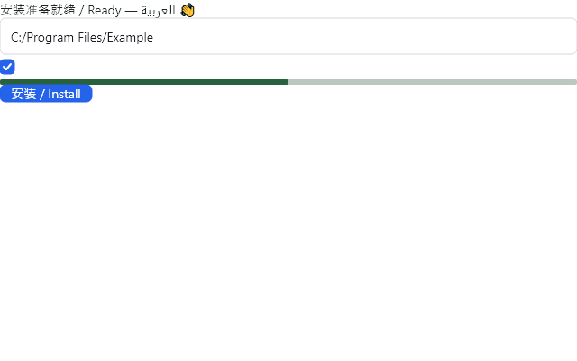

# OneUI 按需构建实测

真实 OneUpdate 整包、ICU/字体配置、72 组画面和 Win7 流程的后续结果见 [OneUpdate 安装包实测](oneupdate.md)；下文保留首轮测试界面的独立数据。

2026-11-22，Windows x64。实现提交 `05a6f3330fe6668a06e9c885026ba103a9fce8e9`，基线 `dde054e3f85235b556bfec50d56635bab464ce6a`。

## 结果

同一安装界面测试程序、同一 MSVC v145 Release 工具链、同一 Skia/Yoga 输入，CPU 光栅输出 640×400。最终版本使用按需运行时与 `ONEUI_STATIC_IPO=ON`。

| 指标 | 优化前 | 优化后 |
|---|---:|---:|
| EXE 字节 | 13,654,528 | 11,907,072 |
| EXE MiB | 13.0220 | 11.3555 |
| C++ 导出数 | 2246 | 0 |
| 首次视图挂载中位数 ms | 23.5055 | 24.0403 |
| 重绘中位数 ms/帧 | 0.673205 | 0.674915 |
| 重绘 P95 ms/帧 | 0.693390 | 0.690740 |
| 响应式更新中位数 ms/次 | 0.004408 | 0.004373 |

体积减少 **12.80%**，节省 1,747,456 字节。重绘与更新接近基线；首次挂载增加 0.5348 ms（2.28%）。本次没有证明性能显著提升，也没有证明任意应用都能达到相同体积收益。

两次绘制的全部 BGRA 像素逐字节一致，SHA-256 为 `eec7832a1638c6f888310b8daa17ae0718af5bc50558f9e05ce52ab126c5daa6`。样本包含中文、阿拉伯文、Emoji、输入、复选框、进度、命令调用与响应式更新。




## 方法与边界

- 固定逻辑 CPU 4、High 优先级，21 组进程交错运行，每组反转顺序；每个进程 21 个批次，每批 20 次重绘及 100 次属性更新。表格是各进程指标的中位数，P95 一列是进程内 P95 的跨进程中位数。全部原始采样见 `comparison.json`。
- `startup_ms` 只统计进程内首次视图挂载，不包含创建进程或首次绘制。CPU 光栅结果不代表 GPU、其他设备或真实产品整包的启动性能。
- 只修复导出的阶段样本为 13,314,048 字节；组件裁剪但未启用 IPO 的阶段样本为 11,964,928 字节。非 IPO 的固定 CPU 试测曾出现约 13% 重绘中位数回退，不能把体积降低直接等同于速度提高。最终 IPO 对照恢复到接近基线。
- 当前交付是 OneUI 主线源码能力。OneUpdate 已发布安装包、Worker、签名模板和生产服务未替换；本表不是其正式安装包的新体积。
- 默认 SDK 保持完整 Unicode、字体回退、渲染和动画能力。IPO 默认关闭，跨工具链分发不能混用特定编译器的中间代码。

## 验证

- CTest 18/18 通过：完整视图运行时、热重载、六组 viewc 回归、Unicode 一致性、文字布局、静态 C API、字体、交互、新依赖清单、遗漏组件明确失败、SDK 归档清单和导出契约。
- 固定 MSVC v143 14.44 的 x86/x64 导出契约分别编译并在本机运行：静态 EXE 导出 0、DLL 导出 2、未引用实现标记已删除。原始记录见 `export-contracts.json`。
- C/Rust ABI 及支持符号清单检查通过；新 requirements sidecar 不改变 OneView IR。
- Win7 完整客户端以及 macOS/Linux 本轮未做原生实机验收。v143 导出契约不替代整套 Win7 功能验收。

## 复现

先在同一源码提交建立基线，保留基线 EXE；再按 `docs/demand-builds.md` 启用 `oneui_target_demand` 与同工具链 IPO，构建 `oneui_demand_benchmark`。执行：

```text
python -B scripts/compare-demand.py before.exe oneui_demand_benchmark.exe <现有构建目录>/comparison --pairs 21 --cpu 4
```

首次基线使用完整工厂和带 DLL 标记的静态对象；只添加相同测试夹具，没有加入新的生产实现。

## 本机产物

本次复用 `E:/project/byname/oneui/build/demand`；当前逻辑占用约 4566.1 MiB，包含复验程序、对比基线与构建缓存。显式清理释放 0 字节。

自动审批先拒绝清理本轮可再生对象目录 `E:/project/byname/oneui/build/demand/CMakeFiles/oneui_core.dir`（116.6 MiB），随后也拒绝了排除该目录、仅删除其余 `.obj/.lib/.exp/.pdb/.pch/.ilk` 缓存文件的更窄清理操作。两次仅返回 `blocked by policy`，没有提供更具体原因；没有执行删除，未继续尝试。正式源码、其他工作区和共享 SDK/Skia 输入保持保留。报告生成时 E 盘空闲约 19.9 GiB。
